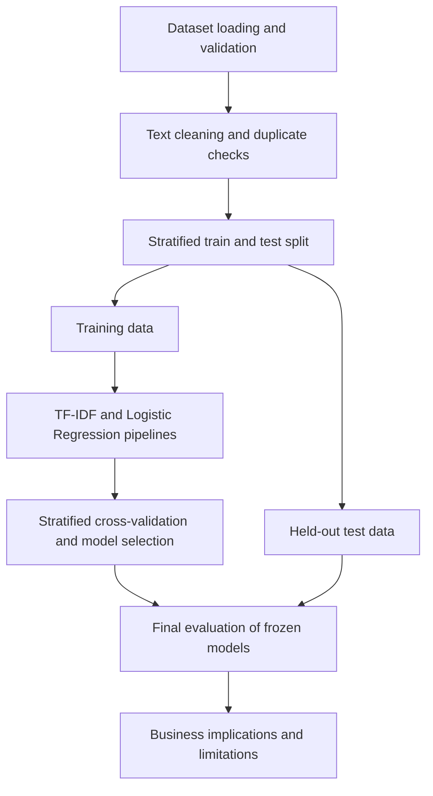

# Hate Speech Detection Using Natural Language Processing

**AI domain:** Natural Language Processing (NLP) | **Capability:** Text Classification | **Business application:** Content Moderation

An AI PM – CT portfolio project exploring how machine learning can identify potentially racist or sexist hate speech in social media text and support human moderation decisions.

> Project status: Under development. Notebook execution and model performance validation are pending.

## 1. Business Problem

Social media platforms receive large volumes of user-generated content. Manual review alone can be difficult to scale. An NLP classification model could help prioritize potentially harmful content for human review while minimizing unnecessary flags on legitimate expression.

## 2. Project Objectives

- Apply tweet-specific text preprocessing and TF-IDF (Term Frequency–Inverse Document Frequency) feature extraction.
- Establish a Logistic Regression baseline and evaluate class balancing.
- Optimize regularization through stratified cross-validation.
- Evaluate model performance and explain precision-recall trade-offs in terms of business outcomes.

## 3. Dataset

The project uses an authorized local copy of `TwitterHate.csv`, containing the following fields:

| Field | Description |
| --- | --- |
| id | Tweet identifier |
| label | 0 = non-hate; 1 = hate speech |
| tweet | Original tweet text |

The notebook will validate missing values, duplicate texts, conflicting labels and class distribution. The CSV is not distributed in this repository because redistribution permissions have not been verified. See [dataset instructions](data/README.md).

## 4. Methodology



Tweet preprocessing will use NLTK (Natural Language Toolkit) TweetTokenizer, handle and URL removal, case normalization and hashtag processing while preserving meaningful negation. TF-IDF will use up to 5,000 features and be fitted within training folds to prevent leakage. Duplicate or conflicting normalized texts will be addressed before splitting.

## 5. Model Development

| Model | Purpose |
| --- | --- |
| Majority-class reference | Establish a simple comparison point |
| Baseline Logistic Regression | Establish initial classification performance |
| Class-Balanced Logistic Regression | Assess the effect of balanced class weights |
| Hyperparameter-Tuned Logistic Regression | Tune compatible regularization and solver settings using GridSearchCV and four-fold StratifiedKFold |

Positive-class recall is the primary tuning metric. Precision and F1-score will also be reported. Model selection will use training cross-validation only; the held-out test set will not be used for fitting or tuning.

## 6. Model Performance

| Model | Accuracy | Hate speech precision | Hate speech recall | Hate speech F1 |
| --- | --- | --- | --- | --- |
| Majority-class reference | Pending | Pending | Pending | Pending |
| Baseline Logistic Regression | Pending | Pending | Pending | Pending |
| Class-Balanced Logistic Regression | Pending | Pending | Pending | Pending |
| Hyperparameter-Tuned Logistic Regression | Pending | Pending | Pending | Pending |

Confusion matrices, class support, execution environment and actual metrics will be documented after validation. No performance claims are made at this stage.

## 7. AI Product Management Perspective

| Classification outcome | Business implication |
| --- | --- |
| True positive | Harmful content correctly flagged for review |
| True negative | Legitimate content correctly left unflagged |
| False positive | Legitimate expression unnecessarily flagged; additional moderation workload |
| False negative | Potentially harmful content missed |

Recall measures how much labeled hate speech is detected; precision measures how many flagged tweets are actually labeled hate speech. F1 summarizes their balance. A product decision must consider both missed harmful content and the cost of unnecessary review.

## 8. Responsible AI and Limitations

This is an educational prototype, not an operational Twitter/X moderation system. The proposed workflow flags content for human review rather than automatically removing it. Dataset labels cover a limited definition of hate speech and may not generalize across communities, languages or contexts. Sarcasm, quotations and identity terms may cause errors. Fairness has not been established. Production use would require representative evaluation, policy alignment, oversight, appeals and monitoring.

## 9. Repository Structure

Current foundation and planned deliverables:

```text
.
├── README.md
├── LICENSE
├── .gitignore
├── requirements.txt
├── data/
│   ├── README.md
│   ├── .gitignore
│   └── TwitterHate.csv              # local only
├── notebooks/
│   ├── README.md
│   └── Hate_Speech_Detection.ipynb  # planned
└── docs/
    ├── README.md
    ├── project-scope.md
    └── validation.md               # planned
```

## 10. Getting Started — Google Colab

Once the notebook is available and the foundation is merged, open the notebook in Google Colab and run its setup section:

```python
!git clone https://github.com/antonypradeep54/Natural-Language-Processing---Text-Classification---Hate-Speech-Detection.git
%cd Natural-Language-Processing---Text-Classification---Hate-Speech-Detection
!pip install -r requirements.txt
```

Upload your authorized dataset into the repository's `data/` directory in the Colab runtime. The planned notebook will include numbered Markdown explanations followed by code cells. Run cells in order. Dependency versions will be pinned after successful environment validation.

## 11. Future Enhancements

Potential extensions include contextual transformer models such as BERT, validation-based threshold selection, fairness evaluation and a human-in-the-loop moderation prototype. These are outside the current scope.

## 12. Documentation and License

- [Project scope and acceptance criteria](docs/project-scope.md)
- [Dataset instructions](data/README.md)
- [MIT License](LICENSE) — applies to original project code and documentation, not third-party datasets.

Part of the AI PM – CT portfolio, based on the original educational assignment “Help Twitter Combat Hate Speech.”
